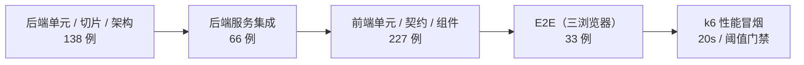

# 质量体系与测试策略

> 这份文档面向两类读者：接手项目的工程师，以及准备面试/简历的维护者。
> 所有数字来自当前仓库的本地与 CI 产物，随代码演进需同步更新。

## 1. 体系概览

四层测试，重心在底层，E2E 只保留最高价值的跨端链路：

| 层级 | 工具 | 真实组件 | 不启动 |
|---|---|---|---|
| 后端单元 / 切片 / 架构 | JUnit 5 + Mockito + AssertJ + ArchUnit + MockMvc standalone | Controller、校验、异常映射 | Spring 容器、数据库、Redis |
| 后端服务集成 | JUnit 5 + Testcontainers | Service、MyBatis、MySQL 8、Redis 7 | 浏览器、前端 |
| 前端单元 / 契约 / 组件 | Vitest + Vue Test Utils + jsdom | 页面编排、Pinia、路由守卫、组件状态 | 后端、浏览器、真实 HTTP |
| E2E | Playwright（Chromium / Firefox / WebKit） | 前后端 + MySQL + Redis + 浏览器 | - |
| 性能冒烟 | k6 | 真实后端 + 数据库 | - |

## 2. 门禁

| 门禁 | 规则 | 位置 |
|---|---|---|
| 后端覆盖率 | 行 ≥ 80%，关键类单独阈值 | `backend/pom.xml` JaCoCo `check` |
| 前端覆盖率 | 行/语句 ≥ 90%、分支 ≥ 90%、函数 ≥ 80% | `frontend/vitest.config.ts` |
| 接口契约 | Controller 路由、前端调用、真实响应三层对齐 | `contracts/openapi.json` + `ApiContractTest` / `contract.spec.ts` / `api-contract.spec.ts` |
| 性能 | p95 < 800ms、失败率 < 1%、checks > 99% | `frontend/perf/smoke.js` |
| 部署 | 测试工作流失败则不构建、不推送、不部署 | `build-deploy.yml` 的 `needs: tests` |

## 3. 关键设计决策

- **集成测试不用 H2**：项目使用 `CAST(... AS UNSIGNED)`、`DATE_FORMAT` 等 MySQL 方言，H2 的“绿”不可信；用 Testcontainers 起真实 MySQL 8，容器按 JVM 复用。
- **Controller 切片不启动 Spring**：`MockMvcBuilders.standaloneSetup` 只装配 Controller + 全局异常处理 + Bean Validation，Service/Mapper mock；毫秒级反馈，且不依赖数据库。
- **集成测试直接调 Service**：聚焦事务、持久化、乐观锁、通知落库；HTTP 契约交给切片，真实链路交给 E2E，避免三层重复。
- **E2E 造数走真实 API**：不直连数据库，换环境即可跑；每个用例使用随机项目/用户，避免数据串扰。
- **覆盖率排除 `views`**：页面行为用“编排测试 + E2E”覆盖，避免为脆弱 DOM 断言刷覆盖率；关键派生逻辑抽成纯函数（`utils/schedule`、`utils/bug`、`utils/requirementForm`）单独覆盖。
- **契约唯一事实来源**：`contracts/openapi.json` 同时约束后端路由、前端调用与真实响应，任何一端漂移都会在 CI 失败。

## 4. 结果可见性与 Flaky 管理

每次 CI 产出：

- `backend-test-reports`：Surefire / Failsafe XML + JaCoCo HTML
- `frontend-coverage`：Vitest 覆盖率 + JUnit XML
- `frontend-e2e-report`：Playwright HTML/JSON/trace/video + k6 summary JSON
- `test-summary`：`scripts/test-summary.mjs` 聚合的 Markdown，同时写入 GitHub Step Summary

Flaky 策略：

1. E2E 仅在 CI 重试 1 次；重试后通过的用例由 Playwright 标记为 `flaky` 并进入摘要，不静默忽略。
2. `flaky` 出现后 2 个工作日内定位：优先消除时间/数据依赖，其次缩小用例范围；禁止用全局提高重试次数掩盖问题。
3. 后端不使用盲目重试；时间相关逻辑统一走 `TestClock`，数据通过 `Fixtures` 构造，保证可复现。
4. 需要临时隔离的用例打 `@quarantine` 标签，由独立非阻塞 job 运行并跟踪清除（后续阶段落地）。

## 5. 面试讲法（STAR）

- **Situation**：内部项目管理系统，前后端 + MySQL/Redis，早期只有零散接口测试，回归靠手工。
- **Task**：建立可门禁、可观测、可持续演进的测试体系，并让部署真正依赖质量结果。
- **Action**：
  - 按成本分层：Controller 切片、服务集成、前端组件/页面、E2E 各司其职；
  - 用 Testcontainers 替代 H2，保证数据库方言与事务真实；
  - 以 `contracts/openapi.json` 为唯一事实来源，做后端反射、前端静态扫描、E2E 响应结构三层校验；
  - 引入 k6 阈值与三浏览器冒烟，并将测试工作流作为部署硬前置；
  - 聚合四层报告到 Step Summary，用 flaky 数而不是“全绿”衡量稳定性。
- **Result**：464 个用例（138 + 66 + 227 + 33），前端行覆盖 93%、E2E 33 例三浏览器通过、性能 p95 约 20ms，测试失败即阻断部署。

简历 bullet 示例：

- 设计并落地四层测试体系（464 用例），以 Testcontainers 真实 MySQL/Redis 替代 H2，后端行覆盖 85%+、前端行覆盖 93%。
- 建立 OpenAPI 单源契约与三层校验，拦截前后端路由/字段漂移；测试工作流作为部署硬门禁。
- 引入 k6 性能阈值（p95 < 800ms、失败率 < 1%）与 Chromium/Firefox/WebKit 冒烟，CI 统一聚合报告与 flaky 指标。

常见追问与回答要点：

- 为什么不用 `@WebMvcTest`？避免加载 WebConfig/JWT/数据源，切片更纯粹、更快；过滤器链交给 E2E。
- 为什么集成测试不走 HTTP？HTTP 契约已由切片覆盖，服务集成聚焦事务与持久化，减少重复。
- 覆盖率 85% 够吗？覆盖率只说明“执行过”，下一步用变异测试验证断言有效性（阶段 2）。
- 如何防 flaky？固定时钟、API 造数、独立数据、重试可观测、隔离标签，而不是无限重试。
- 契约怎么防漂移？一份 JSON，两端双向比对，E2E 再校验真实响应结构。

## 6. 后续路线

1. **测试有效性**：PIT 变异测试覆盖状态派生与排期计算，按存活变异补断言，目标 mutation score ≥ 60%。
2. **安全与韧性**：从契约生成“端点 × 角色”权限矩阵；ZAP baseline 夜间扫描；Redis/DB/JWT 异常注入。
3. **面试材料**：独立整理 STAR 长版、20 问 Q&A、10 分钟演示脚本与中英简历 bullet。
